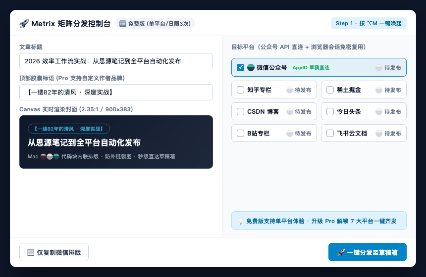
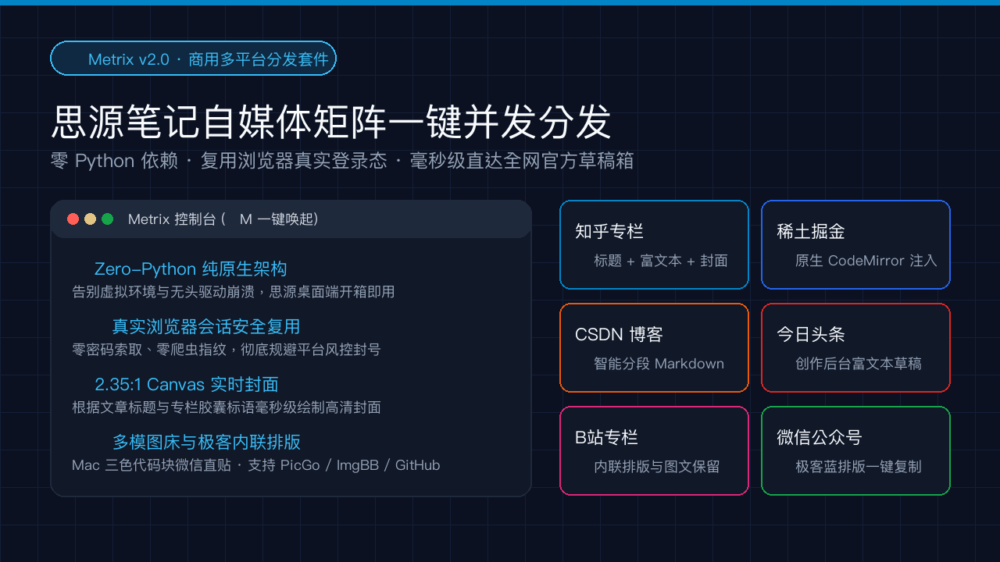

# 🚀 Metrix: Commercial Multi-Platform Publishing Suite for SiYuan Note

**English** | [简体中文](./README.zh-CN.md)

> **Author**: 一缕82年的清风 (`lsqingfeng`)  
> **💎 Official Aifadian Pro License Store**: **[https://afdian.com/item/e617d03cddba11f1bb3552540025c377](https://afdian.com/item/e617d03cddba11f1bb3552540025c377)**

Metrix is a modern, zero-Python multi-platform publishing suite designed for technical bloggers, indie developers, and architects. It supports direct **WeChat Official Account Draft Box API push (`AppID` + `AppSecret`)** alongside authenticated browser-session dispatch into **Zhihu, Xitu Juejin, CSDN, Toutiao, Bilibili, and Feishu Docs** with one click.

---

## 🏗️ Architecture

- **SiYuan Note Plugin (`siyuan-plugin/`)**:
  - `DocParser`: Extracts Markdown, titles, digests, and asset references from active protyle editors.
  - `CoverRenderer`: Real-time HTML5 Canvas rendering of 2.35:1 high-resolution geek-blue cover banners.
  - `ThemeEngine`: Generates Mac terminal styled inline HTML and code blocks for WeChat Official Accounts.
  - `MatrixBridgeServer`: Lightweight local loopback HTTP server (`127.0.0.1:18999`) exchanging ephemeral tokens and payloads with the browser extension.
  - `LicenseManager`: Offline Ed25519 asymmetric digital signature verification for Pro/Team features.
- **Chrome / Edge Companion (`browser-companion/`)**:
  - Manifest V3 browser extension listening for dispatch tasks from SiYuan Note.
  - Reuses your existing authenticated browser sessions without requesting passwords or cookies.
  - Injects drafts accurately into target platform editors via native APIs (CodeMirror, Draft.js, and multiline clipboard events).

---

## 🌟 Key Highlights

1. **Zero Python Dependency**: 100% JavaScript and Node.js. Zero virtualenv setups, zero Playwright/Selenium driver crashes.
2. **Anti-Detection Session Security**: Directly leverages your standard daily browser tabs, eliminating bot fingerprints and account freeze risks.
3. **Smart 2.35:1 Canvas Cover**: Dynamically renders branded banners from your article title and column capsule tagline in milliseconds.
4. **Cloud Image Bed Pipeline (Pro)**: Supports pure geek flow (anti-hotlink safe), local PicGo (`127.0.0.1:36677`), ImgBB, and GitHub + jsDelivr CDN automatic image upload & link replacement.

---

## 🛠️ 30-Second Quick Setup

1. **Install SiYuan Plugin**: Search **Metrix** in SiYuan Marketplace (or extract `package.zip` to `data/plugins/siyuan-metrix`) and enable it.
2. **Install Browser Companion**: Press `⌥M` in SiYuan Note -> click **🧩 Companion Extension** -> export `metrix-companion.zip` -> unzip and load via **Load unpacked** at `chrome://extensions/` (Developer Mode on).
3. **Dispatch**: Press `⌥M` on any note, select your platforms, and click **Publish Matrix to Draftboxes**!

---

## 💎 Upgrade to Lifetime Pro & Sponsor

Support indie development and unlock **unlimited daily runs & all 7 platforms parallel dispatch (Free tier: 1 platform/run, 3 runs/day), custom author/capsule branding, and automated cloud image beds**:

- 👉 **Aifadian Pro License Store (爱发电自动发卡直达)**: **[https://afdian.com/item/e617d03cddba11f1bb3552540025c377](https://afdian.com/item/e617d03cddba11f1bb3552540025c377)**

---

## 📄 License

Distributed under the [MIT License](./siyuan-plugin/LICENSE). Pro/Team features are unlocked offline via Ed25519 cryptographic license keys.
