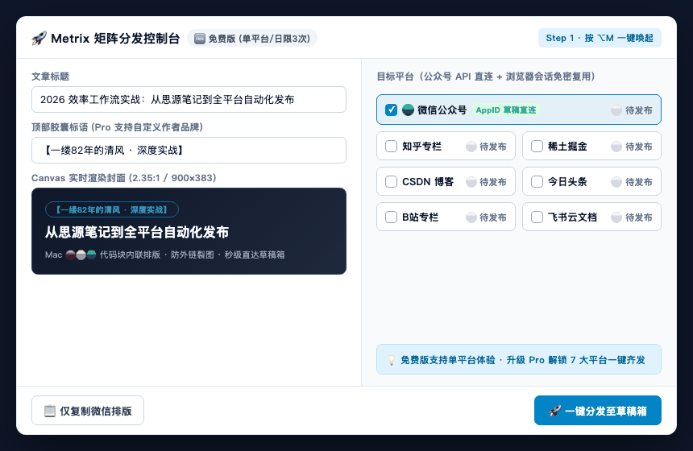
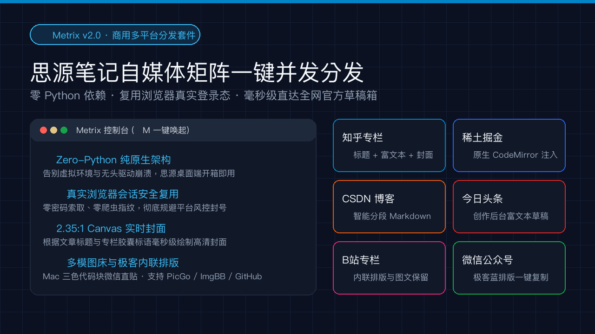

# 🚀 Metrix: Multi-Platform Matrix Publisher for SiYuan Note

**English** | [简体中文](./README.zh-CN.md)

> **💎 Lifetime Pro ¥49 / $7.99 (1-Time Purchase · Offline Ed25519 License · 11-Channel Global & Domestic Parallel Dispatch · Instant Auto-Delivery)**  
> 🛒 **Get Lifetime Pro License on Aifadian**: **[https://afdian.com/item/e617d03cddba11f1bb3552540025c377](https://afdian.com/item/e617d03cddba11f1bb3552540025c377)**

*▲ Live Workflow: Press `⌥M` inside SiYuan Note -> select WeChat Official Account, WeChat Newspic (小绿书), Xiaohongshu, 6 Chinese tech/doc platforms, plus X (Twitter) & Threads -> dispatch formatted drafts & card images simultaneously.*

> **Eliminate fragile Python/Selenium scrapers and tedious manual copy-pasting.**  
> Metrix is a commercial-grade publishing suite designed for technical writers, indie developers, and creators. With zero Python dependencies and native browser session reuse, dispatch articles & graphic cards directly from SiYuan Note into **WeChat Official Account, WeChat Newspic (小绿书), Xiaohongshu (小红书图文), Zhihu, Juejin, CSDN, Toutiao, Bilibili, Feishu Docs, X (Twitter), and Threads** in one click.

---

## 🌟 Why Metrix?

Traditional Python/Playwright automation scripts present severe obstacles:
1. **Environment Complexity**: Requires installing Python, pip packages, virtualenvs, and headless browser binaries.
2. **Account Ban Risks**: Synthetic headless browser fingerprints trigger bot detection, CAPTCHAs, and account freezes.
3. **Maintenance Overhead**: Frequent DOM changes and driver incompatibilities break scripts.

**The Metrix Architecture:**
- ⚡ **Zero Python Dependency**: Pure Node.js and native JavaScript. Works straight out of the box inside SiYuan Note.
- 🛡️ **Session Reuse Security**: Uses your regular Chrome/Edge authenticated sessions. Zero credential sharing and zero risk of bot bans.
- 🎨 **Dynamic Canvas Cover**: Generates a standard 2.35:1 high-resolution geek-blue banner from your title and branding in real time.
- 💻 **Geek Terminal Styling**: Formats terminal code blocks with Mac 🔴🟡🟢 window decorations, ready for one-click WeChat Official Account copy.
- 🖼️ **Flexible Image Pipeline**: Supports pure geek text/code flow (shielded against platform anti-hotlinking), local PicGo integration, ImgBB, and GitHub + jsDelivr CDN image beds.

---

## 📱 Supported Platforms

- **WeChat Official Account (微信公众号)**: Direct Official Draft Box API push (`AppID` + `AppSecret` uploading 2.35:1 Canvas cover + inline images) & 1-click clipboard copy.
- **WeChat Newspic (微信小绿书)**: Direct `article_type: "newspic"` API push via pure JS (`1~20` ordered images + clean text `<=1000` chars). Automatically generates `1~4` high-DPI `1080×1440` `3:4` Canvas cards when a note has no images.
- **Xiaohongshu Graphic Notes (小红书图文)**: Dual-mode anti-ban workflow — **Safe Relay Mode (Default)** mounts an isolated Shadow DOM panel (one-click image batch download + title/clean-body/blue `#topic` pills with zero host DOM events) or **Human-Paced Auto Fill** with randomized delays & topic dropdown selection.
- **Zhihu Column (知乎专栏)**: Automatic title, content, and cover injection with rich formatting.
- **Xitu Juejin (稀土掘金)**: Clean native CodeMirror injection with Markdown code syntax highlighting.
- **CSDN Blog (CSDN 博客)**: Intelligent multiline paste injection preserving headings and paragraphs.
- **Toutiao / Micro-Toutiao (今日头条)**: ByteDance creator platform rich text formatting.
- **Bilibili Articles (B站专栏)**: Preserved inline styling and typography.
- **WeChat Official Account (微信公众号)**: Direct Official Draft Box API push (`AppID` + `AppSecret` uploading 2.35:1 Canvas cover + inline images) & 1-click clipboard copy.
- **Feishu Docs (飞书云文档)**: Structured rich-text draft synchronization.
- **X (Twitter)**: Smart summary extraction (preserving full-text clipboard backup when truncated) + automatic cover/media upload, safely pausing at the Post composer without auto-submitting.
- **Threads**: Auto-opens the composer textbox with clean summary text & media attachments, pausing safely for manual review before posting.

---

## 🛠️ Quick Start (30 Seconds)

### 1. Install SiYuan Plugin
1. Install **Metrix** from the SiYuan Marketplace (or place `siyuan-metrix` into `data/plugins/`).
2. Enable **Metrix** in SiYuan Settings -> Plugins.

### 2. Configure WeChat Direct API or Browser Companion
1. **WeChat Official Account Direct Push (Optional)**: Press **`⌥M`** -> click **⚙️ Settings** -> enter your WeChat `AppID` and `AppSecret` (whitelist your public IP in WeChat MP Settings) -> click **Test Connection**.
2. **Browser Companion (Xiaohongshu/Zhihu/Juejin/CSDN/Toutiao/Bilibili/Feishu/X/Threads)**: Click **🧩 Companion Extension** -> **Export Browser Companion (.zip)** -> unzip and load via **Load unpacked** at `chrome://extensions/` (Developer mode on).

---

## 💎 Free vs. Lifetime Pro Edition

| Feature | Metrix Free | 💎 Metrix Lifetime Pro |
| :--- | :---: | :---: |
| WeChat Official Account & Newspic (小绿书) Draft API Push | ✔ | ✔ |
| Xiaohongshu, Zhihu, Juejin, CSDN, Toutiao, Bilibili, Feishu, X & Threads | ✔ | ✔ |
| Real-time Canvas 2.35:1 Cover & 3:4 Card Pagination | ✔ | ✔ |
| **Dispatch Quota & Parallelism** | **1 Platform / Run · 3 Runs / Day** | **Unlimited Runs & All 11 Channels Parallel** |
| **Author & Cover Capsule Branding** | Preset | **Fully Customizable** |
| **PicGo / ImgBB / GitHub CDN Image Beds** | Pure Flow | **Automated Upload & Link Replacement** |
| **Offline Ed25519 Perpetual License** | Community | **1-Time Purchase, Lifetime Updates** |

- 🛒 **Upgrade to Lifetime Pro (¥49 / $7.99)**: [https://afdian.com/item/e617d03cddba11f1bb3552540025c377](https://afdian.com/item/e617d03cddba11f1bb3552540025c377)

---

## 📄 License
Distributed under the MIT License. Pro features unlock offline via Ed25519 digital signature keys.
