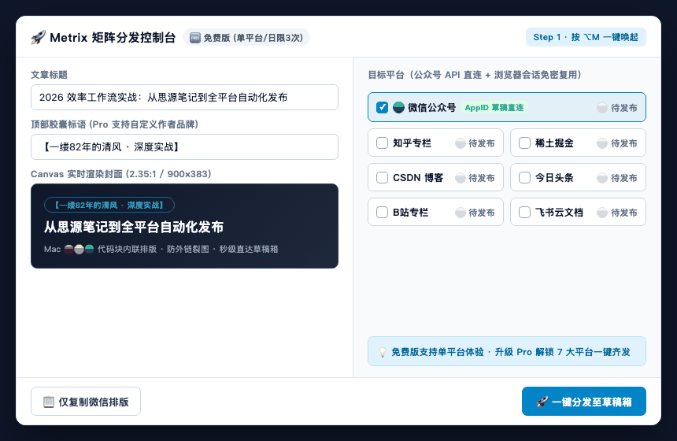
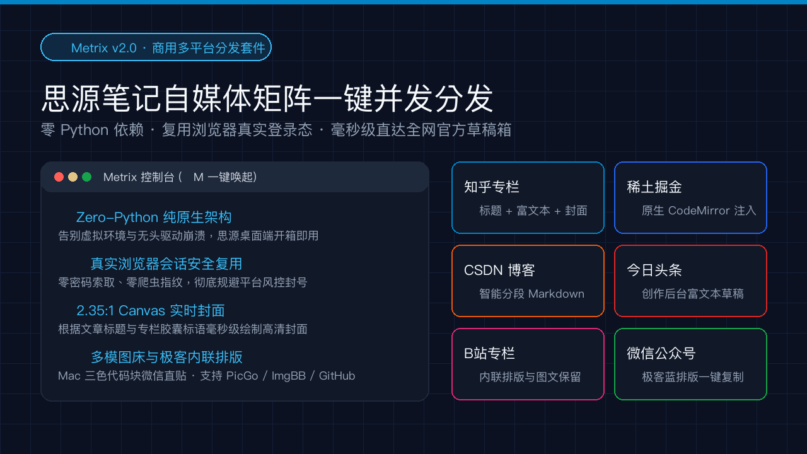

# 🚀 Metrix: 思源笔记多平台矩阵一键分发插件

[English](./README.md) | **简体中文**

> **💎 终身专业版 ¥49 一次买断（Ed25519 纯离线永久授权 · 7 大平台一键并发齐发 · 24h 自动发卡）**  
> 🛒 **立即前往爱发电购买 Pro 激活码**：**[https://afdian.com/item/e617d03cddba11f1bb3552540025c377](https://afdian.com/item/e617d03cddba11f1bb3552540025c377)**

*▲ 实景演示：在思源笔记按 `⌥M` 唤起 Metrix 控制台，Pro 版一键同时勾选微信公众号 + 6 大技术/内容社区，毫秒级写入全部官方草稿箱。*

> **告别繁琐的手动复制粘贴，告别脆弱笨重的 Python 自动化脚本。**  
> Metrix 专为技术博主、独立开发者与架构师打造，纯前端与轻量本地桥接架构，安全复用日常 Chrome / Edge 浏览器已有登录态，一键全自动把思源笔记文章打入各大主流技术与内容社区官方草稿箱！

---

## 🌟 为什么选择 Metrix？

传统基于 Python / Playwright / Selenium 的发帖方案存在三大痛点：
1. **环境极度沉重**：需要在本地折腾 Python 环境、虚拟环境与数以百兆计的 Playwright 浏览器内核；
2. **账号风控风险**：无头爬虫自动化指纹明显，极易触发各平台的风控拦截或账号异常冻结；
3. **维护成本极高**：浏览器版本升级后驱动频繁报错失效。

**Metrix 彻底重构了矩阵分发体验：**
- ⚡ **零 Python 依赖 (Zero-Python)**：纯 Node.js / 原生 JavaScript 驱动，思源笔记桌面端开箱即用；
- 🛡️ **浏览器会话安全复用**：直接复用您日常 Chrome / Edge 浏览器的真实登录态，绝不索取任何账号密码与 Cookie，零封号风险；
- 🎨 **Canvas 智能封面渲染**：自动根据文章标题与专栏定位，毫秒级动态绘制 2.35:1 极客蓝高清封面；
- 💻 **极客内联高亮排版**：内置少数派质感排版与 Mac 🔴🟡🟢 三色终端代码块，一键复制富文本直达微信公众号后台；
- 🖼️ **多模图床自由切换**：默认极客纯净流（防外链盗链裂图），专业版支持 PicGo 本地服务、ImgBB 云图床及 GitHub + jsDelivr CDN 图床自动上传替换。

---

## 📱 支持的目标平台

| 平台名称 | 分发形态 | 特色亮点 |
| :--- | :--- | :--- |
| **知乎专栏** | 官方专栏草稿 | 自动填充标题、正文与 Canvas 封面，保留富文本格式 |
| **稀土掘金** | 创作者草稿箱 | 纯净 Markdown CodeMirror 原生注入，代码块精准高亮 |
| **CSDN 博客** | 官方 Markdown 编辑器 | 智能断行分段，杜绝格式错乱与外链裂图 |
| **今日头条 / 微头条** | 字节头条创作平台 | 自动填充标题、内联排版与富文本结构 |
| **B站专栏 (哔哩哔哩)** | 创作中心专栏 | 原生内联样式与高清图文混排 |
| **微信公众号** | **官方 API 草稿箱直连 + 剪贴板** | **配置 AppID & AppSecret 免浏览器一键将 2.35:1 封面与极客蓝图文直推公众号草稿箱** |
| **飞书云文档** | 官方文档草稿 | 自动同步结构化标题与富文本排版 |

---

## 🛠️ 30 秒极速安装与上手

### 第一步：启用思源插件
1. 在思源笔记「集市 -> 插件」中搜索 **Metrix** 下载并启用（或将解压包放入 `data/plugins/siyuan-metrix`）。

### 第二步：配置微信公众号直连 / 安装浏览器伴侣扩展
1. **微信公众号直连（可选）**：按 **`⌥M`** 打开 Metrix 控制台 -> 点击右上角 **「⚙️ 设置」** -> 填写公众号 `AppID` 与 `AppSecret`（在微信公众平台基本配置中添加本机外网 IP 白名单），点击「测试连接」即可免浏览器直推草稿箱！
2. **浏览器伴侣扩展（同步知乎/掘金/CSDN/头条/B站/飞书）**：点击右上角 **「🧩 伴侣扩展」** -> **「📥 一键导出浏览器伴侣安装包 (.zip)」** 并解压 -> 打开 Chrome/Edge `chrome://extensions/` 开启「开发者模式」->「加载已解压的扩展程序」选中解压文件夹即可永久生效！

---

## 💎 免费社区版 vs 终身专业版

| 功能特性 | Metrix 免费版 | 💎 终身专业版 (Pro / Team) |
| :--- | :---: | :---: |
| 微信公众号 AppID/AppSecret 官方草稿箱直推 | ✔ | ✔ |
| 知乎、掘金、CSDN、头条、B站、飞书全平台连接 | ✔ | ✔ |
| 微信公众号极客内联排版 & 2.35:1 Canvas 封面 | ✔ | ✔ |
| **单次发布平台数 & 每日额度** | **单次 1 个平台 · 每日限 3 次** | **全网 7 大平台不限次数一键并发齐发** |
| **作者署名与封面顶部胶囊标语** | 标准预设 | **任意深度自定义专属品牌** |
| **PicGo / ImgBB / GitHub CDN 图床联动** | 极客纯净流 | **全自动上传图床并替换正文外链** |
| **Ed25519 纯离线永久数字签名授权** | 免费使用 | **¥49 一次买断 · 终身更新 · 零隐私上报** |

- 🛒 **获取终身专业版激活码 (爱发电自动发货)**：[https://afdian.com/item/e617d03cddba11f1bb3552540025c377](https://afdian.com/item/e617d03cddba11f1bb3552540025c377)

---

## 📄 开源与商业许可
基础客户端遵循 MIT 协议分发；专业版高级权益基于 Ed25519 非对称数字签名纯离线验签解锁。
